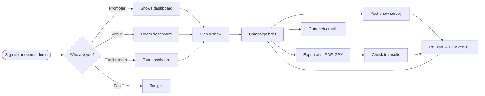
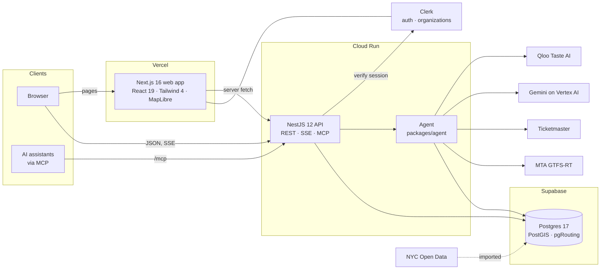
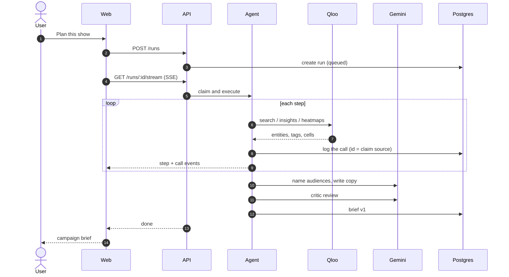
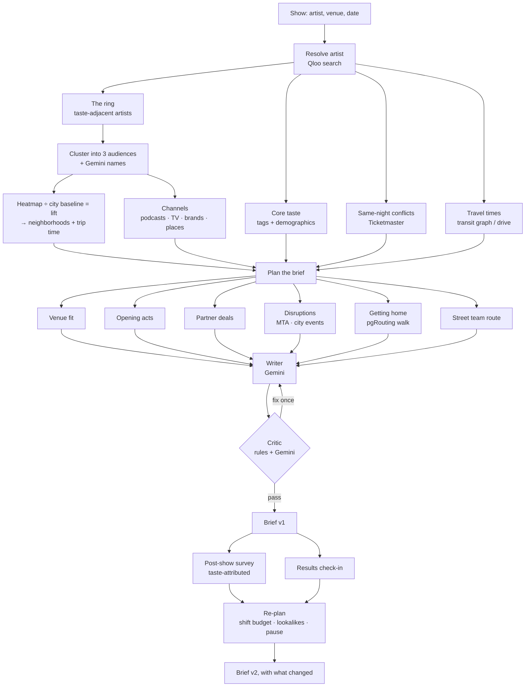

# HouseFull

**Fill the room with fans you don't have yet.**

HouseFull is a campaign agent for live music built on Qloo. Give it a booked show that isn't selling
fast enough and it finds the *next ring* of likely buyers: people whose taste is close to the
artist's and who live within reach of the venue. It works out where they are and how to reach them,
then writes a campaign brief you can start on the same day. When results come in, it re-plans.

It serves promoters, venues and artist teams, each with their own workspace and dashboard. For
fans, *Tonight* shows what's on in the city, ranked by the artists they love.

| | |
|---|---|
| **Live demo** | **https://housefull-two.vercel.app** (no sign-up needed for the demo workspaces) |
| **User guide** | [In the app](https://housefull-two.vercel.app/guide) · [below](#user-guide) |
| **About** | [In the app](https://housefull-two.vercel.app/about) |
| **License** | [MIT](LICENSE) |

---

## Contents

1. [What it does](#what-it-does)
2. [What makes it Qloo-powered](#what-makes-it-qloo-powered)
3. [Try it in five minutes](#try-it-in-five-minutes)
4. [User guide](#user-guide)
5. [Architecture](#architecture)
6. [How the agent works](#how-the-agent-works)
7. [Tech stack](#tech-stack)
8. [Repository layout](#repository-layout)
9. [Run it locally](#run-it-locally)
10. [Environment variables](#environment-variables)
11. [Testing](#testing)
12. [Deployment](#deployment)
13. [Responsible use](#responsible-use)
14. [Data sources and attribution](#data-sources-and-attribution)
15. [License](#license)

---

## What it does

Plan a show (any artist, any venue in New York, New Orleans or Los Angeles, or straight from
Ticketmaster) and in about a minute you get a **campaign brief**:

| Part of the brief | What you get |
|---|---|
| **New audiences** | 3 taste-based groups beyond the core fans, each with the reasons it fits (every reason linked to the Qloo call behind it) |
| **Where and how far** | Neighborhoods where that taste runs high (lift vs. the city's baseline, not population) with transit time (or drive time in LA) to the venue; in New Orleans, the cities visitors travel from |
| **Where to reach them** | The podcasts, TV shows and brands each audience over-indexes on, plus ad-targeting interests |
| **Ad copy** | Three variants per audience (headline, body, call to action), checked by a critic |
| **Opening acts** | Smaller local acts whose fans are the audiences you want |
| **Partners and street team** | Bars, cafés and record stores near the venue with a suggested deal, and a walking poster route (Google Maps link + GPX) |
| **Countdown** | What to do each day until doors open, audience by audience |
| **Show night** (New York) | Same-night competing shows, subway disruptions, street events, and a "getting home" plan (best late-night station, suggested walking route) |
| **Results and re-plan** | Tracking links, check-ins by hand or from a Meta Ads export, a scoreboard per audience, and a new brief version that explains what changed |
| **After the show** | A two-minute anonymous survey (QR code for the venue screens). The artists attendees tick place them in an audience, so you see which audiences loved the night and would come back. The next re-plan uses it |
| **Exports** | Meta and TikTok ad CSVs, a print-ready PDF, GPX for the street team |

On top of the brief:

| Who | Their screen |
|---|---|
| **Promoters** | Every show with tickets sold and days to go, what needs attention, today's step per show, where new buyers are per city |
| **Venues** | Planned shows, the on-sale Ticketmaster calendar (one click to a brief), who the room draws, local partners |
| **Artist teams** | The tour city by city, *taste threads* (what carries across cities), new fans per market |
| **Fans** | *Tonight*: gigs, jazz clubs and pubs with live music, ranked by the artists you love. *Your nights*: save shows, rate them afterwards; loved shows sharpen your picks |

Every workspace also has:
- **Ask your workspace**: questions answered only from your briefs and results, with links to the sources.
- **Outreach**: the places, acts and podcasts from your briefs with contact details (address, phone, website), a drafted email for each, and a status tracker.

## What makes it Qloo-powered

Qloo's taste graph makes the agent's decisions: who to target, where they live, which channels and
partners to use. Gemini names the audiences, writes the copy and reviews it.

| Feature | Qloo API | How it's used |
|---|---|---|
| Resolve the artist | `/search` | Artist name → Qloo entity |
| Core fan profile | `/v2/insights` · `urn:tag`, `urn:demographics` | The taste tags that define the artist's fans |
| **The next ring** | `/v2/insights` · `urn:entity:artist` | Taste-adjacent artists, clustered into 3 new audiences |
| **Where they live** | `/v2/insights` · `urn:heatmap` (geohash) | Per-audience heatmaps divided by a city baseline (*lift*), snapped to neighborhoods |
| Where to reach them | `/v2/insights` · `urn:entity:podcast`, `tv_show`, `brand` | Channels each audience over-indexes on |
| Partners near the venue | `/v2/insights` · `urn:entity:place` + location | Taste-matched bars, cafés, record stores |
| Opening acts | `/v2/insights` · `urn:entity:artist`, popularity cap, explainability | Smaller acts that bring the target audiences |
| Venue fit | `/v2/insights` · `urn:tag`, `urn:heatmap` | How well the act's fans match the room and its area |
| Re-plan lookalikes | `/v2/insights` · `urn:entity:artist` | "More like the audience that converted" |
| Outreach contacts | `/entities` | Address, phone, website, hours, Google place id |
| Tonight: taste ranking | `/v2/insights` with `filter.results.entities` | Affinity of tonight's acts to the artists a fan likes |
| Tonight: walk-in spots | `/v2/insights` · `urn:entity:place` + tags | Jazz/blues clubs, pubs and bars with live music |
| Post-show attribution | The audiences' seed artists | The survey asks "which of these do you also like?": answers map attendees to audiences by taste, with no tracking |

Raw heatmaps had to be corrected for popularity. Our probe of the hackathon API found raw heatmap
affinity correlates with plain popularity at r ≈ 0.99, so it mostly shows where people live. Dividing
by a city-wide baseline drops that to r ≈ 0.07, and what's left is taste. Tonight applies the same
idea to acts, so a small club act close to your taste can outrank a stadium act that's only loosely
compatible.

Each Qloo call is logged with an id, and every reason in a brief carries the id of the call it came
from. A critic drops claims whose source it can't verify. No Qloo response data is stored in this
repository (test fixtures are synthetic).

## Try it in five minutes

No account needed. Open **https://housefull-two.vercel.app** and:

1. **Landing page → How it works.** Click through the six steps; each shows live data from a demo brief.
2. **Explore a demo → Promoter.** Ask *"Which show needs the most help this week?"*, then open a brief.
3. **In the brief:** *New audiences* (map, reasons, ad variants) → *Openers & partners* → *Schedule* →
   *Show night* → *Results*. Try **Without Qloo** to compare with a model that has no data.
4. **Venue demo → Outreach → Write email** on a nearby bar.
5. **Tonight** (header): add an artist you love and see *Top picks for you* and jazz clubs open now.

For a fresh plan, go to *Plan your own show* on the landing page → find a show on Ticketmaster → *Plan this
show* (about a minute). To check in results, upload [`data/samples/meta-results-sample.csv`](data/samples/meta-results-sample.csv)
on the brief's *Results* tab, then **Re-plan from results**.

## User guide

The full guide is in the app at [/guide](https://housefull-two.vercel.app/guide). In short:



| Task | Where | Steps |
|---|---|---|
| Set up a workspace | *Start your workspace* | Sign up → name it → choose promoter, venue or artist team → add your cities, venue or artist |
| Plan a show | Workspace → *Plan a show* | Pick from Ticketmaster or enter artist, venue, date (and optionally % sold, budget) → watch the agent work → open the brief |
| Run the campaign | Brief | Export Meta/TikTok CSVs (ad sets are named `hf-s1-…` so results map back), use the countdown, print the PDF |
| Contact partners | Workspace → *Outreach* | Pick a contact → *Write email* → choose the ask → edit → *Open in email app* → mark as contacted |
| Check in results | Brief → *Results* | Enter clicks, sales and spend per audience, or upload a Meta Ads export |
| Re-plan | Brief → *Results* | *Re-plan from results* (after ≥ 50 clicks per audience or ≥ 5 sales) → version 2 explains what changed |
| Ask a question | Workspace → *Ask your workspace* | Type a question; answers cite the briefs they used |
| Invite your team | Workspace → *Team* | Invite by email; roles come from your organization |
| Find a show tonight | *Tonight* | Pick when, add artists you like, filter by scene or *Intimate rooms only*, *Near me* for distances |
| Survey attendees | Brief → *Results* | Show the QR code at the end of the set or link it in the post-show email; results appear per audience from 10 responses |
| Rate a show you went to | *Tonight* | *I'm going* on a show → afterwards *Your nights* asks *How was it?* → rate; optionally share anonymously with the organizer |

## Architecture



| Piece | Role |
|---|---|
| **Web** (`apps/web`) | Next.js App Router with Cache Components. Landing, workspaces, briefs, Tonight. Talks only to the API; holds no API keys except Clerk's |
| **API** (`apps/api`) | NestJS. Runs execute inside the SSE request that claims them; an ordered event log in Postgres lets any instance replay a run. Rate limits per IP, Qloo budget, Clerk token verification, MCP server |
| **Agent** (`packages/agent`) | The pipeline: Qloo calls, clustering, geography, brief planning, writer, critic, re-plan, Ask, outreach drafts |
| **Database** | Neighborhood boundaries, lift baselines, the NYC walking graph (OpenStreetMap), subway stations and late-night service, permitted events, incidents (aggregates only), runs, briefs, versions, check-ins, workspaces, outreach |
| **Clerk** | Sign-in; organizations are workspaces (promoter, venue or artist team) |

## How the agent works

### One run, end to end



### The pipeline



The critic is deterministic first: every claim must cite a Qloo call made in this run, numbers must
appear in the facts, and protected traits (age, gender, ethnicity, religion, sexuality) are never
mentioned. After that comes one model review. A failed critique gets one rewrite, and it never fails
the run.

## Tech stack

| Layer | Choice |
|---|---|
| Monorepo | pnpm 12 workspaces, Turborepo, Biome, TypeScript 7 (API on TS 6 + SWC) |
| Web | Next.js 16 (App Router, Cache Components), React 19, Tailwind CSS 4, shadcn/ui, MapLibre GL 6 with OpenFreeMap tiles |
| API | NestJS 12, Server-Sent Events, nestjs-pino, @nestjs/throttler, Model Context Protocol SDK |
| Agent | Vercel AI SDK with Gemini on Vertex AI (Flash for analysis, Pro for writing and critique), zod |
| Data | Postgres 17 (Supabase), PostGIS 3.3, pgRouting 3.4, Drizzle ORM |
| Auth | Clerk (organizations = workspaces) |
| Hosting | Vercel (web), Google Cloud Run (API), Supabase (database) |
| Tests | Vitest, Playwright (CI suite + full local end-to-end suite) |

## Repository layout

```
apps/
  web/            Next.js app (landing, workspaces, briefs, Tonight, guide, about)
  api/            NestJS API (runs, SSE, workspaces, ask, outreach, tonight, MCP)
packages/
  agent/          The campaign agent: pipeline, brief, critic, re-plan, ask, outreach
  qloo-client/    Typed Qloo client: cache, budget, retries, call trace
  db/             Drizzle schema, migrations, geo queries, data import scripts
  geo/            Lift, geohash, metro helpers
  events/         Ticketmaster client
  disruptions/    MTA alerts, geocoding, show windows
  feedback/       Tracking links, check-ins, scoring
  shared/         Zod schemas and types shared by web, API and agent
scripts/          Qloo probe, baselines, demo seeding, demo preflight, deploy scripts
data/             Boundary sources, sample results CSV (real Qloo data is never committed)
```

## Run it locally

**Prerequisites:** Node 24.21 (`nvm use` reads `.nvmrc`), pnpm 12 (`corepack enable`), Docker, the
Supabase CLI, and Google Cloud application-default credentials for Gemini
(`gcloud auth application-default login`). Optional for the NYC walking graph: Python 3 with
`pip install osmium`.

```sh
git clone https://github.com/0xhaz/HouseFull.git && cd HouseFull
nvm use && corepack enable
pnpm install

cp .env.example .env          # fill in the keys (see below)
# apps/web/.env.local needs NEXT_PUBLIC_CLERK_PUBLISHABLE_KEY and CLERK_SECRET_KEY

pnpm db:start                 # local Postgres with PostGIS + pgRouting (Docker)
pnpm db:migrate
pnpm import:boundaries        # NYC, New Orleans and LA neighborhoods
pnpm import:nyc               # subway stations + late service, permitted events, incidents
sh packages/db/scripts/import-osm.sh   # optional: NYC walking graph (10–20 min)
pnpm baselines                # city taste baselines for lift (uses Qloo)

pnpm dev                      # web http://localhost:3100 · API http://localhost:4100
pnpm seed:demo                # optional: demo briefs with sample results and re-plans
pnpm demo:check               # preflight: config, services, demo data, live data
```

Without `QLOO_API_KEY` the API runs in demo mode on fixtures; without Gemini it uses deterministic
fallbacks for names and copy.

## Environment variables

Root `.env` (API and scripts). Only names are listed; see [`.env.example`](.env.example).

| Variable | Needed for |
|---|---|
| `QLOO_API_KEY`, `QLOO_API_URL` | Qloo (the hackathon host) |
| `QLOO_DAILY_BUDGET`, `QLOO_PER_IP_DAILY` | Call budgets |
| `GOOGLE_VERTEX_PROJECT`, `GOOGLE_VERTEX_LOCATION`, `GEMINI_MODEL_FAST`, `GEMINI_MODEL_PRO` | Gemini on Vertex AI |
| `DATABASE_URL` | Postgres |
| `TICKETMASTER_API_KEY` | Show picker, conflicts, Tonight |
| `CLERK_SECRET_KEY`, `NEXT_PUBLIC_CLERK_PUBLISHABLE_KEY` | Signed-in workspaces |
| `WEB_PUBLIC_URL` | CORS and the Clerk authorized party |
| `CLICK_SALT` | Click de-duplication (no IPs stored) |
| `UPSTASH_REDIS_REST_URL`, `UPSTASH_REDIS_REST_TOKEN` | Optional shared cache/budget across instances |
| `PRESET_REUSE_HOURS` | How long demo shows replay a finished run |

Web (`apps/web/.env.local`): `NEXT_PUBLIC_API_BASE_URL`, `NEXT_PUBLIC_CLERK_PUBLISHABLE_KEY`,
`CLERK_SECRET_KEY`.

## Testing

```sh
pnpm lint && pnpm typecheck && pnpm test     # Biome, types, unit + integration tests
pnpm --filter @housefull/web test:e2e        # Playwright CI suite (demo mode)
pnpm test:local                              # full end-to-end suite against `pnpm dev`
```

The local suite covers preset replays, every brief tab, a fresh Ticketmaster plan with a Meta CSV
check-in and re-plan, MCP, mobile and dark mode, outreach drafts, Tonight, Ask, the landing diagrams,
and a signed-in workspace flow (Clerk testing tokens).

## Deployment

Web on **Vercel** (root `apps/web`, every push to `main` deploys), API on **Google Cloud Run**
(`us-east4`, image built with Cloud Build), database on **Supabase**. Scripts live in
[`scripts/deploy/`](scripts/deploy): `cloudbuild.api.yaml` (image), `api.sh` (Cloud Run deploy with
Secret Manager references), `secrets.sh` and `vercel-secret.sh` (run by the owner; nothing is printed).
On Supabase, row-level security is on for every table and the Data API roles have no grants: the API
connects as the owner.

## Responsible use

- Audiences are built from what people like. Copy never targets or mentions age, gender, ethnicity,
  religion or sexuality, and the critic and the checks on email drafts and Ask answers enforce this.
- NYPD incident counts appear only as show-night context for promoters, shown as plain counts next to
  similar nightlife areas. They never rank or exclude audiences.
- A fan's location never leaves the browser, and liked artists and rated shows are stored on the
  device. Survey answers are anonymous (no name, email or IP is stored), audience results appear only
  once there are 10 responses, and a fan's rating reaches an organizer only if the fan opts in.
- Outreach drafts never mention ticket sales or budgets, and HouseFull never sends email itself.
- No Qloo response data is committed to the repository; caches live in the private database.

## Data sources and attribution

| Data | Source | Terms |
|---|---|---|
| Taste graph | [Qloo Taste AI](https://www.qloo.com) | Hackathon API terms |
| Shows | [Ticketmaster Discovery API](https://developer.ticketmaster.com) | Ticketmaster terms |
| NYC neighborhoods, events, incidents | [NYC Open Data](https://opendata.cityofnewyork.us) (DCP NTAs `9nt8-h7nd`, permits, NYPD `5uac-w243`) | NYC Open Data terms |
| New Orleans neighborhoods | [data.nola.gov](https://data.nola.gov) (`exvn-jeh2`) | City of New Orleans |
| Los Angeles neighborhoods | [City of Los Angeles GeoHub](https://geohub.lacity.org) (Neighborhood Councils) | CC BY 4.0 |
| Subway schedules and alerts | [MTA](https://new.mta.info/developers) GTFS and GTFS-RT | MTA data terms |
| Walking graph | © [OpenStreetMap](https://www.openstreetmap.org/copyright) contributors | ODbL (the routing database is not published) |
| Map tiles | [OpenFreeMap](https://openfreemap.org), OpenMapTiles | © OpenStreetMap contributors |
| Geocoding | [NYC GeoSearch](https://geosearch.planninglabs.nyc) | NYC Planning Labs |

## License

[MIT](LICENSE) © 2026 HouseFull contributors.
